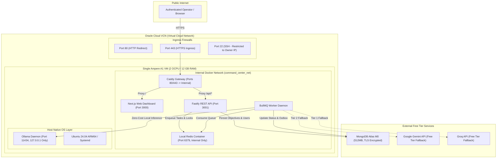
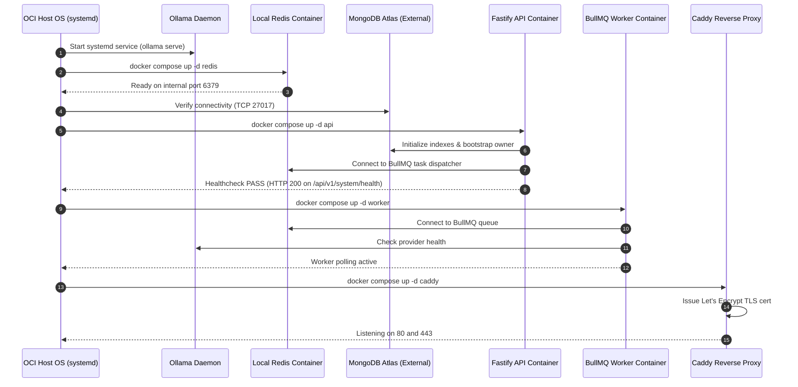

# Phase 9.0 — Deployment Architecture Specification (Corrected)

**Project:** AI Command Center
**Target Environment:** Oracle Cloud Infrastructure (OCI) Ampere A1 (ARM64)
**Hardware Profile:** 2 OCPUs, 12 GB RAM, 75 GB Boot Volume (Single VM)
**Document Status:** Corrected Architectural Specification

---

## 1. Single-Node System Architecture Diagram

---

## 2. Container Startup Sequence & Dependency Graph

On host boot, services start sequentially to prevent connection race conditions:

---

## 3. Redis Placement: Local Container vs. Upstash

**Decision:** **Deploy Local Redis 7 Container on the VM**.
- **Rationale:** All consumers (API and Worker) run on the same physical VM. Deploying local Redis (`redis:7-alpine`) on the internal Docker bridge network eliminates network latency, provides sub-millisecond BullMQ queue operations, avoids Upstash monthly command quotas (500k/month), and consumes < 50 MB RAM.
- **Upstash Role:** Upstash is kept as an optional secondary fallback for multi-node disaster scenarios only, not in primary single-node runtime.

---

## 4. Single-VM Failure Domain & Recovery Boundaries

- **Single Point of Failure (SPOF):** The VM itself is a single point of failure. If the VM reboots or the OCI host experiences maintenance, the entire system is unavailable until the VM returns online.
- **Persistent Data:**
  - Database state is safe on MongoDB Atlas M0.
  - TLS certificates are stored on persistent named volume `caddy_data`.
  - Downloaded Ollama weights are stored on the host filesystem (`~/.ollama`).
- **Graceful Shutdown:** All containers run with `dumb-init` to ensure clean SIGTERM propagation and process flushing before exit.
