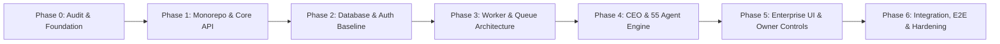

# MASTER PLAN — AI COMMAND CENTER

**Version:** 1.0.0 (Phase 0 Foundation)  
**Author:** Principal Software Architect & DevOps Lead  
**Zero-Cost Policy:** Strictly Enforced

---

## 1. Vision & Purpose

AI Command Center ek autonomous enterprise-grade digital business management platform hai jo ek company ya portfolio ko bina human intervention ke coordinate, monitor, automate aur scale karta hai.
System browser ya Antigravity session par depend nahi karta; iske workers background OS services ya independent worker nodes ke through 24/7 execute karte hain.

---

## 2. Core Pillars

1. **CEO Orchestrator & Department Structure:**
   - 1 Master Autonomous CEO AI Agent.
   - 7 Core Departments (Executive, Engineering, Operations & Automation, Product & Marketing, Finance & Revenue, Business Dev & Discovery, Security & Compliance).
   - 55 Specialist Roles (detailed in `SYSTEM_ARCHITECTURE.md`).

2. **Decoupled Architecture:**
   - **Frontend (Web):** Next.js 15+ App Router, Tailwind CSS, Dark Charcoal Enterprise Theme, Inter font.
   - **API Layer (Core API):** Node.js Fastify/Express + Prisma ORM + JWT Auth + RBAC.
   - **Worker Layer:** Independent Node.js Process using BullMQ + Redis, capable of running continuously via Windows Service / PM2 / Self-hosted VM / Free Cloud Containers.
   - **Persistence:** PostgreSQL (Prisma ORM) with audit-trail schemas.

3. **Zero-Cost & Self-Sovereignty:**
   - $0 budget allocation.
   - Built with open-source frameworks.
   - Fallbacks to generous free-tier external APIs (with explicit owner registration and zero-payment triggers).
   - Central registry prevents accidental cost leakage.

4. **Security & Human-in-the-Loop Safeguards:**
   - Owner Control Center with hard pause/kill-switches.
   - Sensitive action approval gates (e.g., deployments, financial transactions, outbound campaigns).
   - Zero hardcoded credentials; strict environment variable scoping.

---

## 3. Project Roadmap

- **Phase 0 (Current):** Environment Audit, Architecture Design, Monorepo Skeleton, Policies & Risk Registers.
- **Phase 1:** Monorepo Workspace configuration, Core Types, Shared Libraries, Database schemas.
- **Phase 2:** Authentication, RBAC, REST API endpoints, Audit Logging engine.
- **Phase 3:** Redis + BullMQ worker service, background cron scheduler, Playwright automation module.
- **Phase 4:** Multi-agent orchestrator, department dispatchers, prompt pipelines, Free LLM fallback providers.
- **Phase 5:** Next.js Dashboard UI, Real-time status websockets/SSE, Owner Control Center & WhatsApp alert bridge.
- **Phase 6:** End-to-end testing, security audits, disaster recovery, persistent worker deployment scripts.
