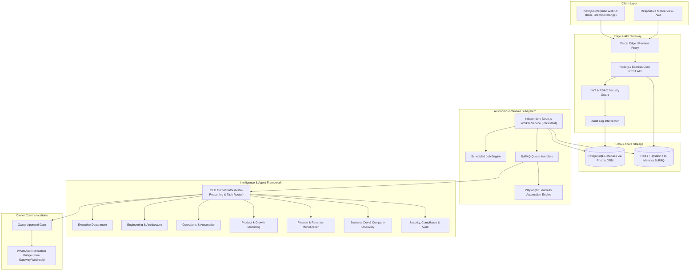

# SYSTEM ARCHITECTURE — ENTERPRISE AI COMMAND CENTER

**Version:** 1.0.0  
**Confidentiality:** Enterprise Internal

---

## 1. High-Level System Architecture

---

## 2. 7 Departments & 55 Specialist Roles

### Department 1: Executive & Strategic Management (5 Roles)

1. **CEO Orchestrator** - Central autonomous coordinator and decision engine.
2. **Chief of Staff** - Task priority scheduler, cross-department mediator.
3. **Enterprise Strategist** - Long-term portfolio and business alignment.
4. **Operations Supervisor** - Quality assurance of automated decisions.
5. **Human-in-the-Loop Gateway Manager** - Escalations to owner and emergency approvals.

### Department 2: Engineering, Architecture & DevOps (10 Roles)

6. **Principal Software Architect** - System design, schema design, API standards.
7. **Lead Full-Stack Engineer** - Web and API development execution.
8. **Frontend Specialist** - Next.js, Tailwind, component library.
9. **Backend Specialist** - REST services, Prisma database access, caching.
10. **DevOps & Cloud Engineer** - CI/CD pipelines, container scripts, Vercel deployments.
11. **Site Reliability Engineer (SRE)** - Uptime monitoring, health check automations.
12. **Database Administrator** - PostgreSQL migrations, indexing, query optimization.
13. **Automation Engineer** - Playwright, scrapers, headless browser orchestrations.
14. **QA & Test Engineer** - Unit tests, integration tests, regression checks.
15. **Release Engineer** - Versioning, changelogs, rollback procedures.

### Department 3: Operations & Process Automation (8 Roles)

16. **Workflow Automation Lead** - BullMQ queue design, job retry topologies.
17. **Data Pipeline Engineer** - Ingestion, transformation, data validation.
18. **Scraping & Discovery Specialist** - Resilient web data harvesting.
19. **Content Publishing Bot** - Multi-channel programmatic scheduling.
20. **Job Queue Monitor** - Dead letter queue handling, failure recovery.
21. **API Integration Handler** - External webhook ingestion and validation.
22. **Document & Media Processor** - PDF/Text/Media parsing and summaries.
23. **System Cleanup Worker** - Cache invalidation, log rotation, temporary storage cleanup.

### Department 4: Product, Marketing & Growth (8 Roles)

24. **Product Manager** - Feature prioritization, user story generation.
25. **Growth Hacker** - Organic acquisition channels, virality experiments.
26. **SEO Specialist** - Keyword tracking, automated sitemap and meta optimization.
27. **Copywriter & Content Generator** - Persuasive marketing copy, blog posts.
28. **Social Media Strategist** - Post drafting, trend alignment, engagement strategies.
29. **Email Marketing Specialist** - Cold outreach sequences, newsletter automations.
30. **Brand & Creative Director** - Design consistency, visual branding rules.
31. **Competitive Intelligence Analyst** - Market competitor tracking and teardowns.

### Department 5: Finance, Monetization & Cost Control (8 Roles)

32. **Chief Financial Officer (CFO)** - Revenue forecasting, budget enforcement.
33. **Zero-Cost Controller** - Real-time spend blocking, API usage meter ($0 limit).
34. **Monetization Strategist** - Pricing models, affiliate channels, checkout setups.
35. **Billing & Invoice Auditor** - Stripe/PayPal zero-fee webhook reconciliation.
36. **Unit Economics Analyst** - Profitability per automated venture.
37. **Expense Watchdog** - Alerts on any outbound request with payment headers.
38. **Payment Gateway Integrator** - Self-hosted / fee-free checkout integrations.
39. **Revenue Attribution Specialist** - Tracking leads to conversion source.

### Department 6: Business Development & Application Discovery (8 Roles)

40. **Discovery Hunter** - Identifies companies, grants, freelance gigs, partnerships.
41. **Opportunity Evaluator** - Scores match probability and expected ROI.
42. **Proposal & Pitch Drafter** - Tailored proposal generation for leads.
43. **Application Submitter** - Programmatic form filling and submission verification.
44. **CRM Manager** - Lead status tracking, contact pipelines, follow-ups.
45. **Partnership Scout** - B2B collaboration and affiliate partner identification.
46. **Outreach Dispatcher** - Email/Form outreach execution.
47. **Deal Closer Assistant** - Contract and requirement checklist verifier.

### Department 7: Security, Compliance & Audit (8 Roles)

48. **Chief Information Security Officer (CISO)** - Security architecture, threat modeling.
49. **Access Control Administrator** - RBAC, JWT validation, token lifecycle.
50. **Secret & Key Vault Guard** - Environment variable masking and validation.
51. **Audit Log Verifier** - Immutable audit trail analysis and tamper detection.
52. **Vulnerability Scanner** - Dependency auditing, npm audit automated checks.
53. **Compliance Officer** - Data privacy (GDPR/local law), terms of service checks.
54. **Rate Limiting & Anti-Ban Specialist** - Proxy rotation, user-agent spoofing protection.
55. **Emergency Kill-Switch Operator** - System-wide pause and worker termination logic.

---

## 3. Database Architecture (Prisma Relational Model)

Core Tables:

- `User`: Owner & administrator credentials (Argon2 hashed, zero plaintext).
- `SpecialistRole`: Directory of all 55 agents, configuration, active status, department.
- `Task`: Queued, running, failed, completed autonomous jobs.
- `TaskLog`: Real-time streaming log of execution per task.
- `AuditLog`: Immutable event ledger for any privileged action.
- `CostRegister`: API cost tracking with zero-dollar guardrails.
- `Opportunity`: Discovered companies, business leads, client proposals.
- `SystemSetting`: Global configurations, owner contact, emergency pause state.

---

## 4. Independent Worker & Persistence Strategy

Browser ya Antigravity band hone ke baad persistent execution ke 3 modes ensure kiye gaye hain:

1. **Local Mode (Dev/Home Server):** Node.js worker process run via Windows Task Scheduler or PM2 (`pm2 start apps/worker/dist/index.js --name "command-center-worker"`).
2. **Container Mode:** Docker Compose stack with restart policy `unless-stopped`.
3. **Cloud Zero-Cost Persistent Mode:** Free tier compute (Render Background Worker / Railway free tier / Fly.io / GitHub Actions scheduled cron runners triggering webhooks).
